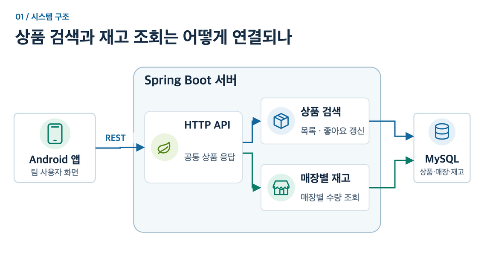
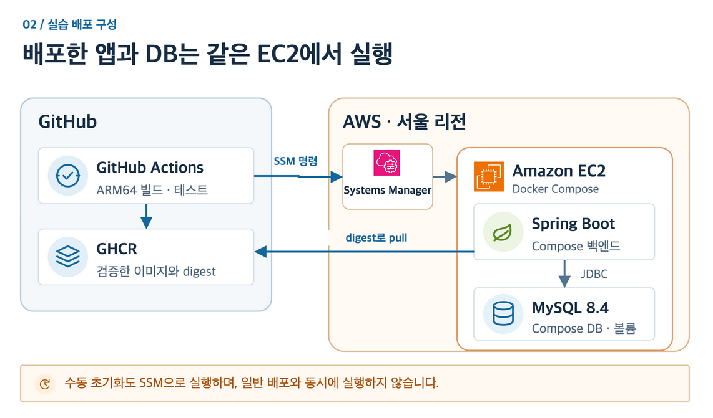
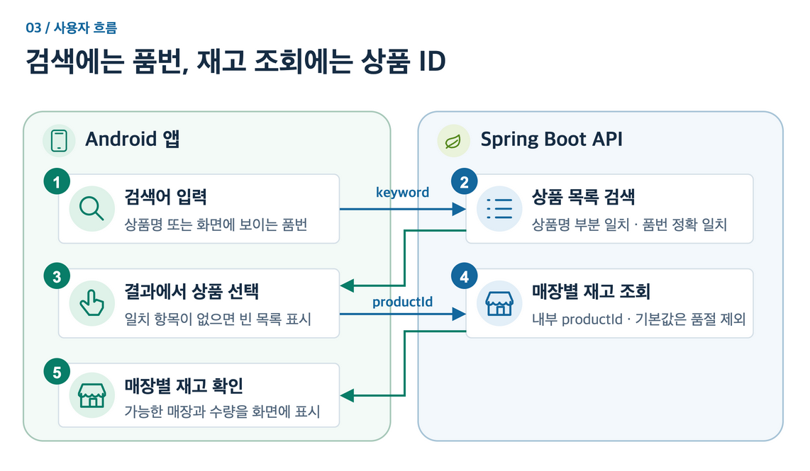

# 다이소 상품 검색과 재고 조회 서버

PLAY SOPT 39기 합동 세미나에서 Android 팀과 함께 만든 Spring Boot 백엔드입니다. 상품명이나 품번으로 상품을 찾고, 결과에서 상품 정보와 매장별 재고를 조회합니다. 로그인 없이 협업 범위의 공유 좋아요·찜 상태를 다룹니다. 협업용 샘플 상품과 재고 데이터를 사용합니다.

## Android 앱 · 팀 시연

https://github.com/user-attachments/assets/65d397b9-c9f7-4214-b87c-db76447b7522

[Android 팀 저장소와 원본 영상](https://github.com/SOPT-all/39-COLLABORATION-ANDROID-DAISO#-시연-영상)

‘VT’를 검색한 뒤 리들샷 상품을 열면 매장별 재고가 표시됩니다.

## Spring Boot 백엔드 · 내가 맡은 부분

- **상품 목록·검색 [PR #13](https://github.com/SOPT-all/39-COLLABORATION-SERVER-DAISO/pull/13):** 상품명 부분 일치와 품번 정확 일치를 한 API로 제공했습니다. 검색어를 생략하거나 공백만 보내면 전체 목록을, 결과가 없는 검색에는 빈 배열을 반환합니다. 결과는 상품 ID 오름차순이며 페이지네이션이나 추천 순위는 범위에 넣지 않았습니다.
- **상품 좋아요 [PR #11](https://github.com/SOPT-all/39-COLLABORATION-SERVER-DAISO/pull/11):** 토글 대신 요청에서 보낸 `liked` 값을 저장합니다. 같은 값을 반복해도 결과가 바뀌지 않으며, 두 번 요청했다고 원래 상태로 돌아가지 않습니다. 여러 요청의 도착 순서를 보장하지는 않습니다. #13에 변경 직후 목록에서 커밋된 좋아요 값을 다시 읽는 통합 테스트를 추가했습니다.
- **실습 서버 구성 [PR #19](https://github.com/SOPT-all/39-COLLABORATION-SERVER-DAISO/pull/19):** ARM64 CI와 이미지 고정 배포 절차를 구성하고 일반 배포에서 데모 데이터 초기화를 분리했습니다. 수동 초기화는 별도 확인과 잠금 아래 기존 앱을 잠시 중지하고 지정된 데모 데이터만 원복합니다. SQL 커밋 뒤 상태 확인이 실패해도 자동 롤백됐다고 판단하지 않도록 문서화했습니다.

팀원의 [매장별 재고 PR #10](https://github.com/SOPT-all/39-COLLABORATION-SERVER-DAISO/pull/10)은 같은 상품 응답 DTO를 재사용하면서 재고를 별도로 조회합니다. [매장 찜 PR #7](https://github.com/SOPT-all/39-COLLABORATION-SERVER-DAISO/pull/7)과 Android 화면도 팀원의 작업입니다.

## 설계에서 중요한 결정

### 식별자와 표시값은 분리

`productId`는 상세·좋아요 API가 쓰는 내부 식별자이고, `productNumber`는 사용자가 검색하는 품번입니다. 저장소에서 가격·리뷰 수는 정수지만, 응답 DTO는 화면에서 쓰는 문자열로 변환합니다. 초기 #13의 가격은 단위까지 포함했으나, 팀 [PR #22](https://github.com/SOPT-all/39-COLLABORATION-SERVER-DAISO/pull/22)에서 스타일링을 위해 숫자 표시와 단위를 분리했습니다. 두 팀원이 다른 작업에서 같은 응답 DTO를 쓰므로 포맷 변경은 상품 목록과 매장 조회에 함께 반영됐습니다.

### 스키마 버전을 합칠 때 데이터도 검증

목록 #13과 매장 재고 #10이 각각 V2를 준비했을 때, #13이 먼저 병합되어 상품 이미지 필수 제약이 V2에 들어갔습니다. #10은 기존 V2를 바꾸지 않고 매장 이미지와 재고 수량의 필수 제약을 V3에 추가했습니다. 팀 PR은 빈 DB에서의 마이그레이션뿐 아니라 기존 V2 데이터 보존과 NULL 데이터 거부도 일회용 MySQL에서 검증했다고 기록했습니다.

| 환경 | 스키마 적용 방식 |
| --- | --- |
| 개인 로컬 | Hibernate `update`; Flyway 비활성화 |
| 별도 검증 DB·배포용 프로파일 | Flyway가 버전별 SQL을 적용한 뒤 Hibernate가 `validate` |

## 시스템 구조

[편집용 draw.io](assets/system.drawio) · [크게 보기 SVG](assets/system.svg)

## 배포와 데모 초기화

[편집용 draw.io](assets/infra.drawio) · [크게 보기 SVG](assets/infra.svg)

## 검색과 재고 조회

[편집용 draw.io](assets/workflow.drawio) · [크게 보기 SVG](assets/workflow.svg) · [구현 근거와 로컬 API 검증](docs/evidence.md)
